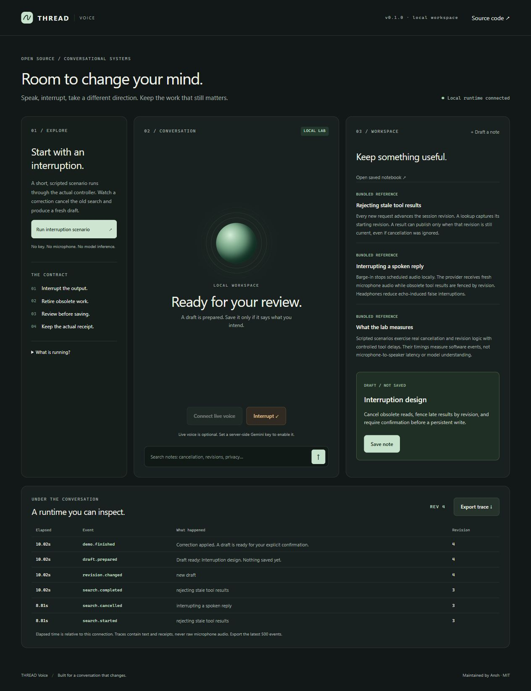
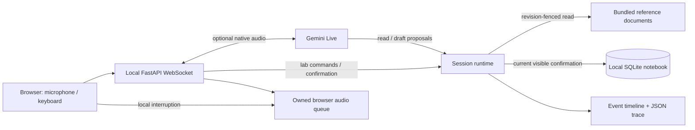

<p align="center"></p>
<h1 align="center">THREAD Voice</h1>
<p align="center"><strong>Room to change your mind.</strong><br>An inspectable voice workspace with interruptible tools and explicit confirmation before persistent actions.</p>
<p align="center"><a href="https://github.com/anshcantcode/thread-voice/actions/workflows/verify.yml"></a> <a href="LICENSE"></a> </p>

A user says “search for interruption handling,” then changes their mind before the lookup finishes. Stopping the spoken reply is only one part of the problem: the old tool result must also lose its ability to publish, and an unconfirmed action must lose its authority to execute.

THREAD makes those boundaries visible. It pairs an optional live voice connection with a local controller, a reference-document search, a note workspace, and an exportable event timeline. The model can prepare a draft. Only the user can confirm its save.

**Status: v0.1.0, an early developer release for one local user.** The lab works without a model or API key. Gemini Live is an optional adapter; its protocol is tested with a fake upstream. This release has not been qualified with a paid live session or a physical microphone-to-speaker latency measurement. See [verification](docs/VERIFICATION.md).

## Try it locally

Python 3.11+ is required. Node 22+ is used only for contributor audio checks.

```bash
git clone https://github.com/anshcantcode/thread-voice.git
cd thread-voice
python -m venv .venv
```

Activate the environment:

```bash
# macOS / Linux
source .venv/bin/activate
# Windows PowerShell
.\.venv\Scripts\Activate.ps1
```

```bash
python -m pip install -e .
thread-voice
```

Open **http://127.0.0.1:8766** and select **Run interruption scenario**. A deliberately delayed local search starts, a scripted correction cancels it, a new lookup finishes, and a draft appears. Review it, then select **Save note** to create a real local SQLite record. The timeline shows each transition. **Interrupt** retires pending work and expires an unsaved draft. A committed save keeps its receipt.

You can also search the bundled engineering notes or prepare your own note with **Draft a note**. The lab does not interpret arbitrary natural-language tasks; its search ranks six reference documents by keyword. The scenario scripts the inputs, not the controller outcomes. It requests no microphone permission and makes no inference request.

<p align="center"></p>

## Optional live voice

Copy `.env.example` to `.env`, set `GEMINI_API_KEY`, and restart `thread-voice`. The CLI reads the environment file from the working directory. `GEMINI_LIVE_MODEL` selects the model available to your Google project. The example uses the model identifier shown in the [Gemini Live capabilities guide](https://ai.google.dev/gemini-api/docs/live-api/capabilities); availability and quota depend on your provider account.

Select **Connect live voice** and allow microphone access. Audio and typed conversation go through the local server to Google. **Provider charges may apply.** The API key stays on the server. Headphones help prevent speaker echo from being detected as user speech. **Disconnect** releases the microphone and provider connection.

The browser streams mono 16 kHz PCM in 20 ms frames. It immediately clears scheduled playback after three above-threshold frames and sends an interruption event. This is an energy-threshold heuristic, not semantic VAD. Google also detects interruptions and reports turn boundaries. Output PCM plays at 24 kHz. The implementation follows the [provider's WebSocket protocol](https://ai.google.dev/api/live).

The model has two tools: `search_docs` and `prepare_note`. Neither writes to the notebook. There is deliberately no model-callable `save_note` tool, arbitrary code execution, arbitrary URL fetch, or filesystem path tool.

## What the runtime guarantees

| Boundary | Mechanism | Runnable evidence |
|---|---|---|
| A late read cannot publish into a newer request | A search captures a monotonically increasing session revision; publication checks it again | Uncooperative-tool regression in `tests/test_runtime.py` |
| An old draft cannot authorize a new write | Confirmation must match both the current proposal ID and revision | Expired and mismatched confirmation checks |
| Repeated confirmation cannot create duplicate notes | Proposal ID is a SQLite primary key; session receipts return the existing outcome | Notebook and runtime idempotency checks |
| An interruption cannot erase a committed outcome | Saved receipts live separately from pending proposals | Save-then-interrupt regression |
| Browser output can stop before a network response | Every scheduled source is owned by the player and stopped by `clear()` | `node tests/audio.test.mjs` |
| Credentials and microphone bytes stay out of trace exports | The public configuration is allowlisted; audio bypasses runtime event storage | Server and adapter boundary checks |

These are software contracts under the tested boundaries. They do not prove perfect speech recognition, model intent understanding, or exactly-once behavior for arbitrary external services.



[Architecture and design decisions](docs/ARCHITECTURE.md) · [protocol](docs/PROTOCOL.md) · [development](CONTRIBUTING.md) · [security and privacy](SECURITY.md) · [roadmap](docs/ROADMAP.md)

## Verify or run in Docker

```bash
python -m pip install -e '.[dev]'
python -m unittest discover -s tests -v
node tests/audio.test.mjs
python scripts/verify.py
```

`scripts/verify.py` runs both suites and a wheel build. GitHub Actions repeats verification on Linux and Windows. Checks use synthetic audio and fake provider messages, with no cloud credentials or paid inference.

```bash
docker build -t thread-voice .
docker run --rm -p 127.0.0.1:8766:8766 -v thread-notes:/data thread-voice
```

For live mode add `--env-file .env`. The application is designed for loopback use; do not expose it as a public service. The Docker port is intentionally published on `127.0.0.1`.

Notes default to `~/.thread-voice/notes.sqlite3`; override with `THREAD_DATA_DIR`. The database persists across restarts. Conversation state and the latest 500 events are session-local and disappear when disconnected. Exports include note and transcript text, so review them before sharing. No raw audio is written by the application.

## Project origin and ownership

Maintained by [Ansh / @anshcantcode](https://github.com/anshcantcode). This is an independently implemented successor to the team's [THREAD hackathon prototype](https://github.com/anshcantcode/thread-team-guide), with a smaller developer-facing scope. The earlier team's source, assets, submission materials, benchmark scores, and contributor authorship are not republished or claimed as this release's work. See [provenance](ORIGINS.md).

The current source is MIT licensed. Contributions are welcome through pull requests; write access is maintained by Ansh.
