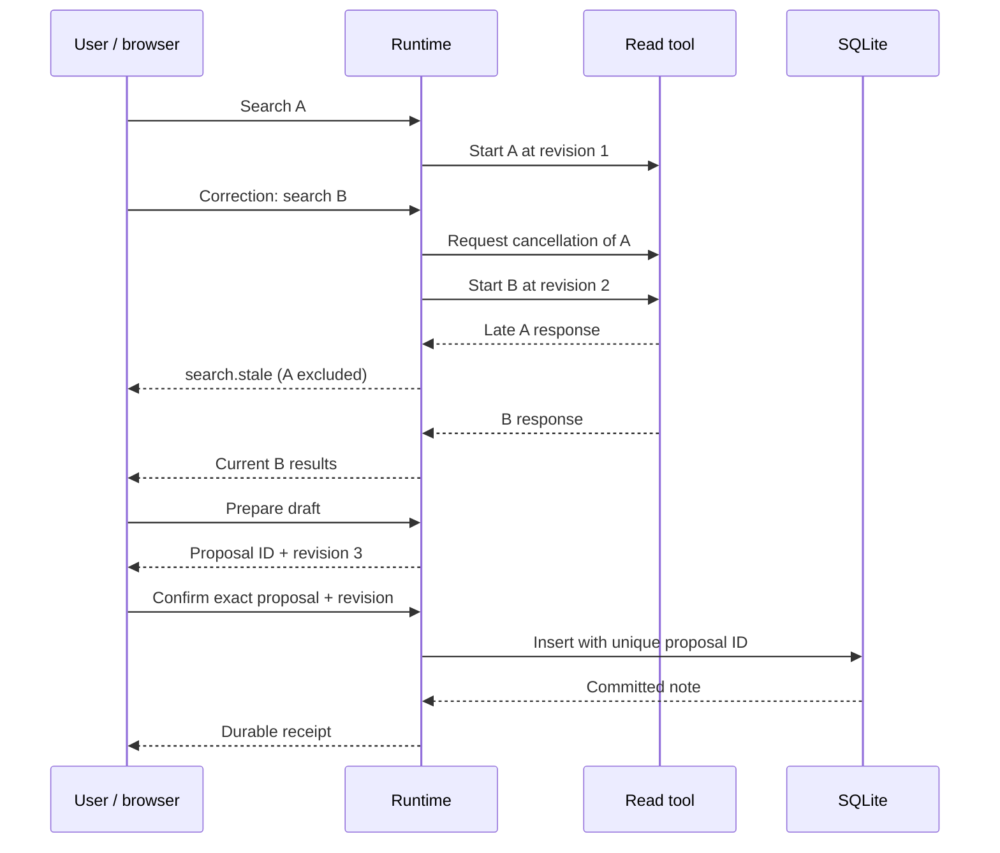

# Architecture

THREAD Voice has three owners of state: the browser owns audible output, a Python `Runtime` owns current work, and SQLite owns committed notebook records. Gemini is an optional interpreter and voice generator. It does not own write authority.

## Request lifecycle

1. A new search increments the session revision and requests cancellation of outstanding reads.
2. The lookup captures that revision before executing.
3. A successful result checks the captured revision against the current one. A mismatch emits `search.stale` without publishing results.
4. Preparing a draft also advances the revision. Its random proposal ID and revision identify the exact content awaiting confirmation.
5. The visible Save control sends that pair. The controller checks both immediately before a SQLite transaction. New speech, another request, or disconnect expires the pending draft.
6. SQLite commits under the proposal ID as primary key. A repeated confirmation returns its prior receipt. Interruptions after commit do not undo a saved note.

Cancellation improves responsiveness; the revision check supplies the stale-result boundary. Those are different responsibilities. Tests intentionally use a read tool that catches cancellation and returns late.

## Audio lifecycle

An AudioWorklet averages source intervals into mono 16 kHz PCM and emits 320-sample frames. Audio is forwarded in memory. The player decodes 24 kHz PCM into separately owned Web Audio sources. Clearing the player stops every scheduled source, including sources that have not started yet.

The local detector uses an RMS threshold of 0.035 for three frames (60 ms of above-threshold input after resampling). That is a software configuration, not a measured acoustic response time. Echo, noise, hardware latency and browser scheduling affect real behavior. Provider-detected interruptions also clear playback and revoke pending work. After local speech onset, the relay suppresses audio until the provider completes its interrupted turn. It does not reconstruct unheard speech after false interruptions.

## Deliberate limits

- One local user; up to eight sockets, 15-minute sessions, bounded messages and a 256-message output queue. No distributed session storage or account authentication.
- Latest 500 events retained for export; the UI shows 100. Raw audio never enters these events. Text and note content do.
- Search uses a six-document local corpus. It is a demonstration tool with real execution, not retrieval over a user's filesystem or a web search service.
- The SQLite transaction is synchronous and small. External side effects would require a separate durable submission/outcome protocol and recovery checks.
- Reconnection starts a new session and expires pending proposals. Notes persist; conversation context does not.
- A model tool may propose an inaccurate draft. Visible confirmation is an execution boundary, not a guarantee of semantic correctness.
- Live API protocol behavior is checked with a fake upstream. A real provider and acoustic qualification remain release gates before claiming measured live reliability.

## Source map

| File | Responsibility |
|---|---|
| `src/thread_voice/runtime.py` | Revision ownership, cancellation, proposal expiry, receipts, scripted scenario |
| `src/thread_voice/storage.py` | Parameterized SQLite insert and receipt lookup |
| `src/thread_voice/live.py` | Gemini transport, audio suppression, read/draft-only model tools |
| `src/thread_voice/server.py` | Local HTTP/WebSocket boundaries, input limits, socket ownership and cleanup |
| `src/thread_voice/web/audio.js` | Scheduled playback, microphone lifetime, local speech onset |
| `src/thread_voice/web/capture-worklet.js` | Continuous frame conversion at 16 kHz |
| `tests/` | Adversarial runtime, transport, persistence and synthetic audio checks |
